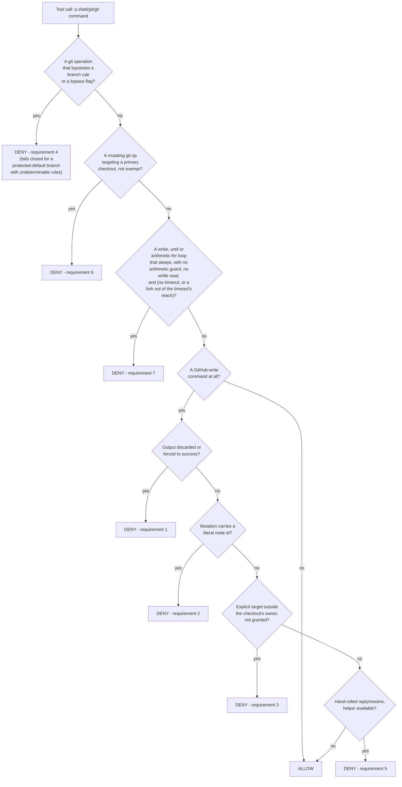
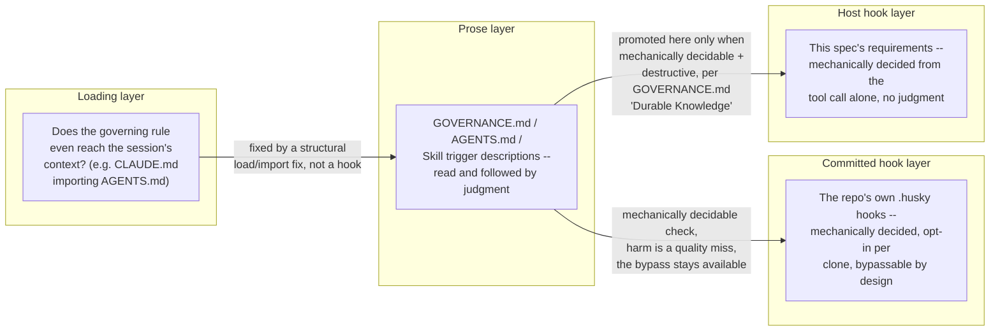

# Agent Host-Safety Spec

What any coding agent must be stopped from doing when it runs unattended on this host, stated once,
independent of which agent implements it. Most of it guards the maintainer's `gh` credentials, which
is where the harm started. Requirements 7 to 9 guard the machine itself, which is the other thing
an unattended agent takes down. Requirement 10 guards the maintainer's model choice and quota. This file is the source
of truth: an implementation is built from the requirements below, and an implementation is audited
by checking its decisions against them, not by reading its source as the implicit spec.

## Why This Exists

A mis-targeted GitHub write acts publicly under the maintainer's identity: a fabricated node id
once posted a stray comment, as the maintainer, to a stranger's repository. A mutating git command
run directly in a primary checkout destroys another task's uncommitted work without ever reaching
GitHub. An unbounded shell wait outlives every agent in the run that wrote it, and a machine carrying
enough of them has to be rebooted. All three incidents happened under prose rules the agent had
already read. None was fixed by writing the rule more clearly. [`GOVERNANCE.md`][governance] "Durable Knowledge and Self-Improvement"
states the general criteria for when a rule like this earns a mechanical hook instead of staying
prose. The requirements below are that criteria applied to this host.

A hook implementing these requirements bounds a mistake by an agent acting in good faith, not an adversary, and it is not a sandbox. A parse gap is out of scope when only a command shape no agent plausibly types in a normal coding session reaches it. Such a gap is declined as out of scope rather than fixed, and the local review of a hook change does not file it. A hook's own size is a cost too, since every later review reads each hardening change again. A shape is therefore added only when a session produced it or plausibly would. This applies [`GOVERNANCE.md`][governance] "Trust Boundaries and Hardening Effort" to the hooks, per the decision (ptr727, 2026-10-23) on [issue #3391][issue-3391], item 1.

## Requirements

Each requirement is stated as a decision rule, precise enough to implement against any agent's own
hook or approval-gate API, not tied to Claude Code's `PreToolUse` JSON shape. Requirement 8 is
stated against the end of a session rather than against a tool call, because what it covers has
already happened by the time any tool call is judged. Requirement 9 bounds every command whatever its
text says, because the harm it covers was never in the text.

Requirements 1 to 7 judge a command's text, read the way a simple lexer reads it. The text splits into commands on a newline, `;`, `&&`, `||`, `|`, and `&` outside quotes, honoring single and double quotes and backslash escapes. Each command is read as its words, with leading `VAR=value` assignments and redirections set aside. A `$(...)` or backtick substitution stays part of its word and is not read. A heredoc body is data, never commands. An `export VAR=value` or a `VAR=value` earlier in the text is the environment a later command sees. A `cd` or `pushd` earlier in the text moves the directory a later command runs in. Each of those ends at the closing parenthesis of a subshell holding it. A launcher such as `timeout`, `nohup`, `env`, or `xargs` is read past to the command it runs. The literal string an `sh -c`, `bash -c`, `eval`, or `xargs ... sh -c` runs is read the same way, one level deep and no deeper. A shape this reading does not reach is allowed, except under requirement 4.

1. **A GitHub write with its output discarded or forced to success is denied.** The write is a mutating `gh` call or a `git push`. Its output goes to `/dev/null` (`>/dev/null`, `2>/dev/null`, `&>/dev/null`), or `|| true`, `|| :`, or `|| echo` follows it. Either hides the one signal that tells a client-reported failure apart from a server-side success. Deny it, so the write runs again with its result visible. A tail on a wrapper shell or an `eval` counts for the write inside it. A tail the reading does not attach to the write, such as one on an enclosing group, is allowed.
2. **A GraphQL mutation carrying a literal GitHub node id is denied.** Node ids resolve globally, so a fabricated, stale, or hand-typed id can land on a real object in a different repository. A literal id is an uppercase-letter prefix such as `PR_`, `PRRT_`, `IC_`, or `BOT_` followed by a long body, or the legacy `MD`-prefixed base64 form. It is denied as a `-f`/`-F` field value of a `gh api graphql` mutation, and as a quoted string in the mutation's query text. A `-F name="$VAR"` value is allowed. A static hook cannot see where a variable's value came from, and this rule's job is the literal-id mistake. The fleet's prose rule (`GOVERNANCE.md` "Repository Boundaries and Write Safety") requires that the value came from a live query. A query read from a file, as in `query=@file.graphql`, is not read and is allowed.
3. **A GitHub write with an explicit target outside the checkout's own owner is denied, unless the maintainer granted it.** Each target the write names is compared against the owner of the checkout's `origin`. A sibling repository under the same owner is allowed with no grant, since the harm this guards is reaching a stranger's repository, not working across one maintainer's own fleet. A different owner is allowed only when named in a grant read from the environment the session was launched with. A tool call cannot change that environment for its own session. So an inline `VAR=x cmd` prefix or an `export` in the same call never satisfies it. A write is a known-mutating `gh` subcommand, a `gh api` call whose method is not GET, or a GraphQL mutation. It names a target by any of these:
   - an `-R`/`--repo` value in any of gh's spellings, read by the owner in `[HOST/]OWNER/REPO`
   - a `repos/<owner>/<repo>` endpoint on a `gh api` write
   - a `GH_REPO` value set before a write carrying no repo flag, in its prefix, earlier in the text, or in the session's environment
   - a pull request or issue URL among its arguments
   - the repository a `gh repo` write such as `edit` or `delete` takes, and the destination of `gh issue transfer`
   - an `--org`, `--owner`, or `-o` value other than `@me`

   When no `origin` resolves, no owner exists to compare against, and this requirement does not fire. A target held in a run-time word, as in `--repo "$T"`, is not read and is allowed.
4. **A git operation that would only succeed by bypassing an active branch rule is denied.** The explicit bypasses are denied whatever the branch, since each is the bypass itself. They are `--admin` on `gh pr merge` and `--no-verify` on a commit or push. They include a commit's `-n`, alone or in a short-option cluster such as `-an`. They include a `-c` override of `core.hooksPath` or of an include (`include.path`, `includeIf`) on a commit or push. A push is also judged against the *live* rules of each branch it writes. Those rules deny a direct push to a branch whose rules require a pull request. They deny a force-push where history is protected, and a delete where deletion is blocked. So a code-style `develop` denies and a config-style `develop` allows with no per-repo configuration. A force-push and a delete each write the branch too, so a branch whose rules require a pull request denies them as it denies a direct push. A push writes the branch each refspec names, read as git reads `src:dst`, `+src`, `:dst`, `HEAD`, and a `refs/heads/` destination. A push naming no refspec and no `--tags` writes the branch checked out where it runs. `--force`, `--delete`, `--all`, and `--mirror` apply as git applies them, and `--all` or `--mirror` is read as writing every branch protected by default. The rules are those of the repository the push's remote writes, read from the remote's push URL or from a URL the push names. **This one fails closed, but only for a branch protected by default** (`main`, `master`, `develop`): when that branch's rules cannot be determined at all (network unreachable, origin unresolvable), deny rather than allow, because the harm is a silent success under the maintainer's own admin bypass. A push to any other branch whose rules cannot be determined passes, since there is nothing yet on record to bypass. A refspec naming no branch the reading resolves, such as a run-time word or a pattern, is allowed. So is a push an alias or a script runs.
5. **A hand-rolled reply or resolve on a review thread, bypassing the one-call helper, is denied (where a helper exists) unless the maintainer's cross-owner grant already covers it.** Splitting a reply and a resolve into two separate hand-run API calls is what let a reply sit unresolved across a push, reading as untriaged. Where the agent's fleet ships a single documented helper for this (this repo's `scripts/pr_review.py reply --resolve`), a `resolveReviewThread` mutation or a POST to the review-comment replies endpoint is denied in favor of it. The one exception is a target the maintainer has already granted this session: the helper itself refuses a cross-owner pull request outright, so the hand-run form is then the documented fallback for that specific repository, and this is allowed through the same grant channel requirement 3 reads. A REST reply's own URL is checked against the grant. A `resolveReviewThread` mutation's thread id is opaque, so any active grant is the only signal available there, a residual gap this requirement accepts. A mutation the reading cannot see, such as one in a file or behind `--input`, is allowed.
6. **A mutating git operation run directly against a primary checkout is denied.** "Primary" means not a linked worktree. The decidable test is a comparison, not a filesystem-shape guess: `git rev-parse --path-format=absolute --git-dir --git-common-dir` returns equal paths for a primary checkout and unequal paths for a linked worktree. A `.git`-is-a-directory heuristic is wrong, since a submodule's `.git` is a file yet still a primary working tree that can lose uncommitted work.
   - **Denied there:** `reset`, `rebase`, `cherry-pick`, `revert`, `restore`, `add`, `commit`, `rm`, `mv`, `apply`, `am`, and `push`, whatever their arguments. Also `merge` and `pull` without `--ff-only`, `stash` other than `list` or `show`, a forcing `clean`, and a forced `worktree remove`. `push` is denied too, though it does not touch the working tree, because no documented fleet workflow pushes from a primary checkout.
   - **Allowed there:** any read, `worktree add`, `list`, and `prune`, an unforced `worktree remove`, `merge --ff-only` and `pull --ff-only`, and a `clean` carrying `-n` or `--dry-run` before any `--`. A `checkout` or `switch` is allowed with exactly one positional argument, either `-` or one that resolves as a ref (`git rev-parse --verify --quiet <ref>^{commit}`), and no force flag. A force flag (`-b`, `-B`, `-c`, `-C`, `-f`, `--force`, `--discard-changes`, `--orphan`) is recognized bundled into a short-option cluster such as `-qf` or attached as in `-Bname`. A `--`, more than one positional argument, or one that is not a ref is a pathspec restore. It is denied, since git's own refusal to overwrite a local change covers only the ref switch. These exemptions are the documented way an agent uses a primary checkout as a fetch source and returns it to a base branch. The incident behind this requirement ran exactly that shape, an unforced `checkout` then an `--ff-only` pull. The concurrent-access hazard those commands still carry stays the prose rule's job (`GOVERNANCE.md` "Repository Boundaries and Write Safety", `repo-worktree`).

   A git command targets the session's working directory. Each `cd` or `pushd` earlier in the text moves it, and then each `-C` on the command, as git composes them. `~` and `$HOME` are expanded. On Windows a Git Bash drive spelling such as `/c/repos/x` reads as `C:/repos/x`, and a rooted path with no drive is not resolved. Fail open (allow) when no git repository resolves there, since the harm needs a positively identified primary checkout. A directory the reading does not resolve, such as a run-time `-C "$D"` value or a `cd -`, is not followed, and a command there is allowed. A `--git-dir`, a `--work-tree`, a `GIT_DIR`, and an alias are not read. The grant is `GH_WRITE_GUARD_ALLOW_PRIMARY_CHECKOUT`, read from the same session-start environment as requirement 3's. It is a boolean rather than an `owner/repo` list, granted by any value but a falsy one ("0", "false", "no", "off", or empty).
7. **A shell wait carrying no bound is denied.** `until <condition>; do sleep <n>; done` and `while ! <condition>; do sleep <n>; done` are what an agent writes when it is told to poll, and what runs until the machine is rebooted when the condition never comes true. The shell is not the agent's to end either: a shell started by a tool call runs in a session of its own, so it outlives the turn, the subagent, and the run that started it, and nothing reaps it. Deny a `while` or `until` loop, or a `for ((;;))`, whose condition or body calls `sleep`, unless it carries one of these bounds. A worker reproduces a quoted shape and not an adjective, so each is named exactly.
   - **A `timeout` running the wrapper that holds the loop**, as in `timeout 600 bash -c '<the loop>'`. That placement is the only one that works, since `timeout` takes a command and a loop keyword is not one. A wrapper body that forks work out of the timeout's reach, by a `&` or a `setsid`, is not bounded by it. A `timeout` the command backgrounds as a whole, as in `timeout 900 bash -c '<the loop>' &`, still bounds the loop.
   - **An arithmetic guard in the loop's own condition**, a test with `-lt`, `-le`, `-gt`, or `-ge` such as `[ "$i" -lt 120 ]`, or an arithmetic comparison such as `(( SECONDS < 600 ))`. A `for` loop over a word list, or an arithmetic `for` whose condition compares, is bounded the same way.
   - **A `while read` condition**, which ends with its input.

   A nested loop is judged on its own terms, so an unbounded inner wait is denied inside a bounded outer one. An inner `sleep` makes an unbounded outer loop a wait too. A loop in an `eval` string is read, and no `timeout` bounds it, since `timeout` cannot run a builtin. A heredoc body is data, so a document quoting the forbidden shape is written rather than denied. Some shapes are deliberately not reached, each for the same reason requirements 1 to 3 and 6 give. A busy loop with no `sleep` is not distinguishable from a loop doing ordinary work. A guard comparing against a counter the body never increments is textually a bound and is infinite anyway. A wait in a script file, a heredoc fed to a shell, or a wrapper nested past one level is unseen. A `timeout` sending a signal that ends nothing is still read as a bound, and so is a `read` from an input that never ends. A false deny on an ordinary loop costs more work than those leaks do, and each still falls under `AGENTS.md` "Delegation", which states the prohibition for every agent whether or not a hook is installed.

8. **A process outliving the session is reported, never killed.** Requirement 7 stops a leak from
   being written, and requirement 9 stops what the session's own bounded commands leave behind. This
   one finds the leaks still running: the ones a session started before either reached this machine,
   the shapes requirement 7 deliberately does not reach, and anything else this agent left
   running outside requirement 9's groups, whether it leaked or not. At the end of a session, report every descendant
   of the agent process that runs outside the agent's own session, since a descendant sharing that
   session ends when the agent does and one in a session of its own does not. Report the root of
   each such subtree rather than every process under it, name each root's command and age, and hand
   over the exact command that ends them.

   What a descendant walk does not reach is a process whose own tool-call shell has already exited,
   since init reparents it and it leaves the agent's tree entirely. The leak this requirement exists
   for is the backgrounded tool-call shell itself, which stays a child of the agent for the whole
   session, so the gap is a process that shell in turn backgrounded and then abandoned. Say so rather
   than implying the sweep is exhaustive, because a report read as complete is worse than one read as
   partial.

   **Never kill anything.** A long build backgrounded on purpose is not distinguishable from a
   leaked wait at this point, and what on the machine is still wanted is the maintainer's call.
   Report a failure to sweep as loudly as a finding, since a sweep that cannot read the process
   table and a sweep that finds nothing are different answers that silence renders identically. This
   is the only requirement here that is not a denial, and it is a requirement rather than a nicety
   because the alternative is that nobody learns the leak happened at all.

9. **Every command is bounded on tasks and memory, and what it leaves running ends with the
   session.** Requirement 7 reads the command text, and the harm here was not in it. A probe wrote
   a command shim that called itself through `PATH`, the command ran the probe only by name, and the
   chain grew past half a million processes before the host had to be reset. Run each command inside
   a resource-control group of its own carrying a task ceiling and a memory ceiling, so a runaway
   fan-out fails at the ceiling with a visible error. The ceiling belongs to the group rather than to
   the foreground wait, so it still holds after the tool moves a timed-out command to the background
   and after the command's own shell has exited.

   Name each group for the session that ran it, and at the end of the session stop every group its
   commands left running, then report what was stopped. This stop needs none of requirement 8's
   judgment about what a process is, since the group's name proves which session started it. Report
   a failure to list or to stop a group as loudly as a finding.

   A hook the agent runs, a guard above included, is not placed in a group. A group that fails to
   start fails the command, and a guard that fails that way is a guard that did not run. Nor is a
   tool server the agent's harness launches for itself, such as an MCP server, which serves the
   harness rather than any one session.

   Where the host offers no such group, commands run unbounded and the host's installation report
   says so, because a silent fallback reads exactly like a bounded host. A host that registered the
   bounding and later lost its group says so on every command instead.

   The maintainer sets the ceilings, where a variable set inline in the bounded command cannot reach
   them. They bound an accident rather than an adversary, since a command can still raise its own
   group's limits or start a group outside it, and the incident this answers was a mistake.

10. **A subagent dispatch at the maintainer-only model tier is denied, unless the maintainer allowed
    it when the session started.** A skill named the `frontier` tier in a repository whose
    instruction set carried no tier table. It was taken as "the frontier model", and the work ran on
    the most capable and most expensive model nobody had asked for. Read the tier mapping from the
    hub's `spec/model-tiers.json`, deployed beside the hook. Refuse a dispatch naming the
    maintainer-only tier's model unless the session was launched with that tier allowed. An agent
    never sets the allowance, for its own session or for one it launches. A mapping the hook cannot
    read refuses every dispatch naming a model, since a guard that cannot tell what to block must
    not go quiet. A session launched with the allowance blocks no model, so it needs no mapping.

    This one guards the maintainer's choice of model and his quota rather than the credentials or
    the machine. It sits in the host layer all the same, because a dispatch happens inside the
    harness, where no hook a repository carries can see it. It refuses only a dispatch that names
    the model. A saved workflow, a child workflow a script starts, a computed model, and an agent
    definition pinning one all pass. So do a dispatch naming no model and a fork naming another
    model, which run at a model the hook cannot read. So does a nested session an agent launches
    with the allowance set, which is circumvention rather than the mistake this guards.

## Decision Flow

The first diagram is this spec's actual decision flow, generalized from `claude/gh-write-guard.py`'s
`classify()`. Requirements 8, 9, and 10 appear nowhere in it, deliberately. None judges a command's
text, and requirement 10 judges a subagent dispatch instead. Requirement 9 wraps every command the flow allows, and requirement 8 runs once at the end of a
session on whatever the denials and the ceilings did not prevent. The second is why a failure lands in one layer and not another. A rule that never
reached the session at all is a loading bug, fixed the way PR #1081 fixed `local-strict-review`'s
missed trigger, by wiring `CLAUDE.md` to import `AGENTS.md`. A rule that reached the session and
was still not followed, where the trigger is mechanically decidable and the harm is destructive,
is promoted to a host hook. Requirement 6, above, tracked at [issue #1073][issue-1073], is the
worked example, and requirement 7, tracked at [issue #1589][issue-1589], is the second: the prose
rule against an unbounded wait was read, quoted into six worker briefs, and produced the forbidden
shape in all six. A rule whose violation can only be judged, not mechanically decided (was a
review finding actually evidence-backed?), stays prose and a chained Skill trigger, since a hook
there could only nag, never decide.

The committed layer between those two is not this spec's, and it is drawn because leaving it out
made the picture read as a binary it is not. A hook the repository carries in its own tree is
opt-in per clone, visible to anyone reading the repo, and bypassable on purpose, so it can carry a
rule whose harm is a quality miss rather than a destruction, which the host layer's bar excludes.
The hub's own `.husky/pre-push` is the worked example there, refusing a branch push that no
recorded local review pass covers, per [`GOVERNANCE.md`][governance] "Verification Discipline".
The two layers meet at requirement 4, which denies `--no-verify`, a `-c core.hooksPath=`
override, and an include override on a commit or push unconditionally, wherever it reads them. So
a Claude Code session meets a committed hook it
cannot wave through with any of them while a human keeps the escape hatch. They do not compose into a
seal, and saying so would be the more comfortable claim rather
than the true one. A committed hook is bypassable by construction, since it cannot police its own
invocation, and `--no-verify` is the documented route rather than the only one. This requirement
list also reaches Claude Code alone today, per the Per-Agent Status table below, so a Codex or
opencode session meets the committed hook with every route still open. What a committed hook buys
is a rule that fails loudly at the moment it is broken instead of silently, for the agent whose
bypasses this spec covers. It is not a substitute for the prose layer, which is the one that binds
every agent.

## Per-Agent Status

| Agent | Status | Implementation |
| --- | --- | --- |
| Claude Code | Every requirement, via `PreToolUse` hooks, a shell prefix, and a `SessionEnd` sweep | [`claude/README.md`][claude] |
| Codex | No hook yet -- tracked at [issue #781][issue-781] | [`codex/README.md`][codex] |
| opencode | No hook yet -- tracked at [issue #781][issue-781] | [`opencode/README.md`][opencode] |

GitHub Copilot carries no subdirectory here: it reviews through GitHub's own hosted infrastructure
rather than running local shell commands under the maintainer's credentials, so it has no analogous
local host-safety hazard for this kit to cover.

## Auditing an Implementation Against This Spec

Run each of the implementation's own self-tests (`claude/gh-write-guard.py --selftest`,
`claude/stray-process-sweep.py --selftest`, `claude/tool-containment.py --selftest`, and
`claude/model-tier-guard.py --selftest` for Claude Code) and compare every case against the
requirements list above, one by one, rather than reading the implementation's source as though it
were the spec. A case the self-test doesn't cover is a gap in
the audit, not evidence the requirement is satisfied. This is the concrete shape of "ask Claude to
audit the Claude hooks against the spec" or "ask Codex to implement Codex's own hooks against the
spec": point the agent at this file's requirements, not at another agent's source code.

<!-- Repo -->
[claude]: ./claude/README.md
[codex]: ./codex/README.md
[opencode]: ./opencode/README.md
[governance]: ../../GOVERNANCE.md
[issue-781]: https://github.com/ptr727/ProjectTemplate/issues/781
[issue-1073]: https://github.com/ptr727/ProjectTemplate/issues/1073
[issue-1589]: https://github.com/ptr727/ProjectTemplate/issues/1589
[issue-3391]: https://github.com/ptr727/ProjectTemplate/issues/3391
